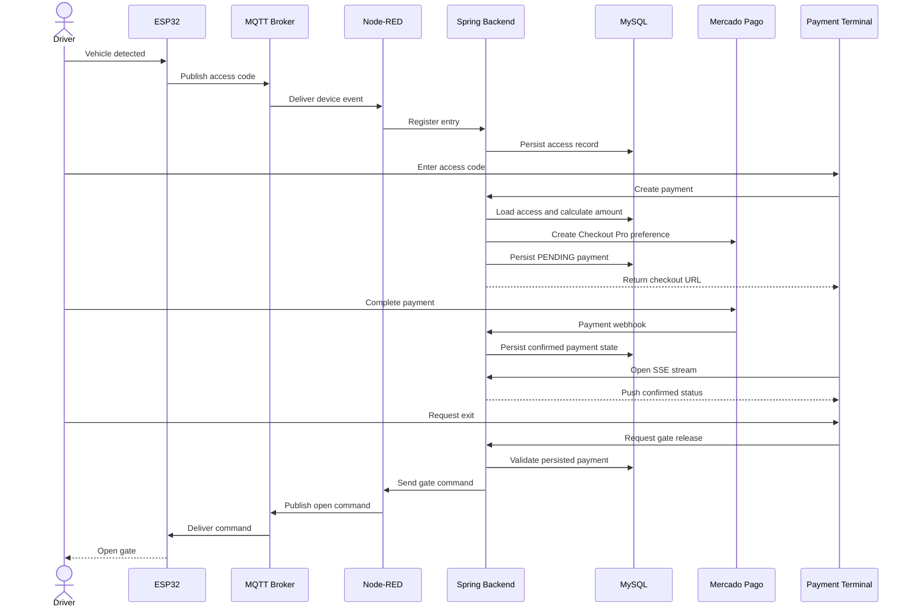
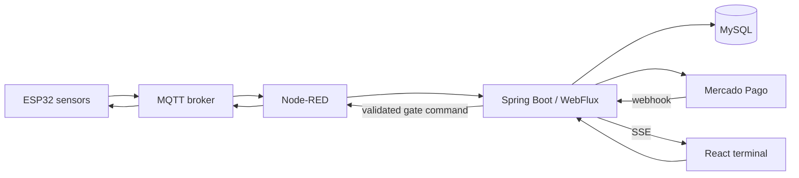

# OpenIt

> IoT access control where the backend, not the frontend, is the authority for payment and physical gate release.

[](https://openjdk.org/)
[](https://spring.io/projects/spring-boot)
[](https://docs.spring.io/spring-framework/reference/web/webflux.html)
[](https://mqtt.org/)
[](https://www.mercadopago.com.br/developers/)

OpenIt is an academic full-stack project that coordinates vehicle entry, payment, real-time status updates, and gate opening across physical hardware and backend services.

The key design rule is simple:

> The gate opens only after payment confirmation has been received and persisted by the backend.

## Problem, decision, result

### Problem

A parking terminal can display optimistic payment state before the backend has durably recorded the transaction. If physical access follows that UI state, a network failure or incomplete payment callback can create a gap between what the user sees and what the system has actually confirmed.

### Decision

Keep payment and access state authoritative in the Spring backend:

- ESP32 devices publish physical events through MQTT;
- Node-RED bridges device messages and backend commands;
- Mercado Pago confirms payment through a webhook;
- MySQL stores access and payment state;
- Server-Sent Events push status updates to the terminal;
- the gate command is allowed only after backend validation of persisted payment state.

### Result

The project implements a six-stage flow from vehicle detection to exit release, integrating ESP32, MQTT, Node-RED, Spring WebFlux, MySQL, Mercado Pago, SSE, React, and TypeScript.

This is a delivered project flow, not a claim of commercial production traffic or financial impact.

## System flow



## Six-stage lifecycle

| Stage | System behavior | Authority |
|---|---|---|
| 1. Entry | ESP32 detects a vehicle and publishes an access code | device event |
| 2. Registration | Node-RED/backend persist the entry record | backend + database |
| 3. Payment creation | backend calculates the amount and creates Checkout Pro preference | backend |
| 4. Confirmation | Mercado Pago webhook updates the persisted payment state | backend + database |
| 5. Live status | terminal receives payment status through SSE | backend stream |
| 6. Exit | backend validates paid state before sending the gate command | backend |

## Architecture



### Component responsibilities

| Component | Responsibility |
|---|---|
| ESP32 | detect vehicles, publish codes, receive gate commands |
| MQTT | lightweight device messaging |
| Node-RED | bridge device topics and backend HTTP commands |
| Spring backend | payment calculation, persistence, validation, webhook handling, SSE |
| MySQL | durable access and payment state |
| Mercado Pago | hosted Checkout Pro and payment notification |
| React terminal | collect access code, redirect to checkout, display live status |

## Why these choices

### MQTT

MQTT fits low-bandwidth device messaging and decouples the ESP32 firmware from direct backend HTTP calls.

### Node-RED

Node-RED acts as an integration bridge between device topics and backend commands. It keeps hardware orchestration outside the core payment domain, though it introduces another component that must be monitored and recovered.

### Spring WebFlux and SSE

The backend uses WebFlux for non-blocking I/O around external integrations and SSE. SSE is sufficient because the terminal primarily receives one-way payment-state updates; a bidirectional WebSocket channel would add complexity without a matching requirement.

### Backend-confirmed payment

The frontend never becomes the source of truth for gate release. Mercado Pago webhook data is processed and persisted before the terminal is notified and before the exit command is accepted.

## Backend boundaries

The backend is organized around access and payment concerns:

- presentation: REST controllers, webhook endpoints, SSE endpoints, DTOs;
- application: entry, payment creation, confirmation, and exit orchestration;
- domain: access and payment rules;
- infrastructure: MySQL persistence, Mercado Pago integration, Node-RED commands.

The important boundary is behavioral rather than cosmetic: external providers and device integration remain outside the core rule that a confirmed persisted payment is required for release.

## Failure scenarios

| Failure | Current or expected behavior |
|---|---|
| checkout created but payment not completed | payment remains pending; gate is not released |
| terminal disconnects from SSE | persisted payment remains authoritative; terminal can reconnect |
| forged frontend success state | ignored because exit validation reads backend state |
| Mercado Pago webhook delayed | gate remains closed until confirmation is persisted |
| Node-RED or broker unavailable | payment may be confirmed, but gate command delivery must be retried operationally |
| duplicate webhook | idempotent handling should be enforced before production use |

## Known limitations

- Webhook idempotency and replay protection need explicit production hardening.
- Device and broker outage recovery is not fully automated.
- There is no published end-to-end hardware simulator or measured webhook-to-gate latency.
- The project does not claim production throughput, uptime, revenue, or commercial deployment.
- A public MQTT broker is appropriate for an academic demonstration, not for a production security posture.

## Verification roadmap

The strongest next evidence would be:

1. an automated payment-provider stub;
2. duplicate-webhook tests;
3. a simulated MQTT/ESP32 integration test;
4. measured webhook-to-SSE and webhook-to-gate latency;
5. broker and Node-RED recovery scenarios;
6. a short demo video showing the complete physical flow.

## Running locally

### Requirements

- Java 21
- Node.js and npm
- Docker and Docker Compose
- MySQL
- MQTT broker and Node-RED flow
- Mercado Pago test credentials

### Backend

```bash
./mvnw spring-boot:run
```

Windows:

```powershell
.\mvnw.cmd spring-boot:run
```

### Frontend

```bash
cd frontend
npm install
npm run dev
```

Configuration should be supplied through environment variables or local configuration excluded from version control. Do not commit Mercado Pago credentials, database passwords, or broker secrets.

## STAR summary

**Situation:** physical gate release could diverge from the payment state durably recorded by the system.  
**Task:** integrate hardware, payment, persistence, and real-time UI updates while keeping one authoritative state.  
**Action:** connected ESP32, MQTT, Node-RED, Spring WebFlux, MySQL, Mercado Pago webhooks, and SSE; validated persisted payment before issuing the gate command.  
**Result:** delivered a six-stage access flow in which the frontend displays status but the backend controls release.

## Author

Built by [Lucas Eckert](https://lucas-eckert.vercel.app).
