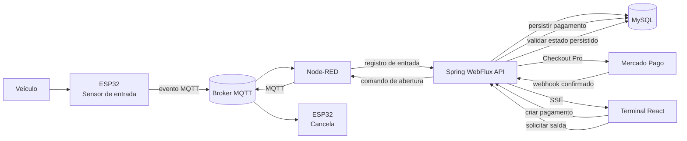
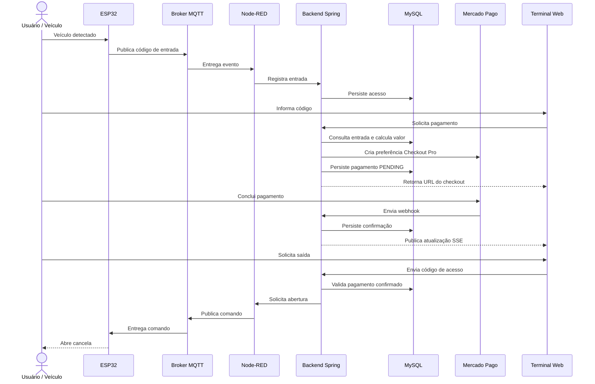

# OpenIt

> Sistema de acesso IoT em que a cancela só recebe o comando de abertura depois que o backend confirma e persiste o pagamento.

[](https://openjdk.org/)
[](https://spring.io/projects/spring-boot)
[](https://docs.spring.io/spring-framework/reference/web/webflux.html)
[](https://mqtt.org/)
[](https://www.mercadopago.com.br/developers/)

OpenIt é um projeto aplicado de controle de entrada, pagamento e saída de estacionamento. Ele integra eventos físicos de um ESP32, comunicação MQTT, orquestração no Node-RED, uma API Spring WebFlux, persistência MySQL, Mercado Pago Checkout Pro e uma interface React/TypeScript atualizada por Server-Sent Events.

O principal requisito de consistência é simples:

> O estado visual do frontend não autoriza a saída. A autoridade é o pagamento confirmado e persistido pelo backend.

## Problema, decisão e resultado

### Problema

Em um fluxo que combina interface web, gateway de pagamento e hardware físico, liberar a cancela com base em redirecionamento do navegador ou estado otimista do frontend cria uma lacuna: a tela pode indicar sucesso antes que o backend tenha recebido, validado e salvo a confirmação do pagamento.

### Decisão

- O backend mantém o estado oficial de acesso e pagamento.
- O Mercado Pago confirma a transação por webhook.
- O pagamento é persistido antes de qualquer comando físico.
- O frontend recebe atualização unidirecional por SSE.
- O backend solicita a abertura ao Node-RED apenas após validar o estado persistido.
- O Node-RED traduz o comando HTTP para MQTT e o entrega ao ESP32.

### Resultado

O sistema coordena um fluxo de seis etapas:

1. detectar e registrar a entrada;
2. calcular a permanência e criar o pagamento;
3. encaminhar o usuário ao Checkout Pro;
4. receber e persistir a confirmação do webhook;
5. notificar o terminal em tempo real por SSE;
6. emitir o comando de abertura após validação do backend.

O repositório representa um protótipo aplicado e validado como fluxo de projeto. Ele não declara implantação comercial, volume de transações, SLA ou disponibilidade de produção.

## Arquitetura



## Fluxo completo



## Responsabilidades dos componentes

| Componente | Responsabilidade |
|---|---|
| ESP32 | Detectar o veículo e executar o comando físico de abertura |
| MQTT | Transportar eventos e comandos de forma leve entre dispositivos |
| Node-RED | Orquestrar a ponte entre MQTT e HTTP sem acoplar diretamente o backend ao firmware |
| Spring WebFlux | Coordenar regras de acesso, pagamento, webhook e atualização em tempo real |
| MySQL | Persistir entradas, saídas e estados de pagamento |
| Mercado Pago | Hospedar o Checkout Pro e enviar a confirmação da transação |
| React/TypeScript | Capturar o código, iniciar o pagamento e exibir o estado recebido por SSE |

## Decisões técnicas

### Backend como autoridade

A URL de retorno do checkout e o estado do frontend não liberam a cancela. O comando só é emitido depois que o backend consulta o registro persistido e confirma que o pagamento está aprovado.

### Webhook em vez de confiar no redirecionamento

O webhook é o sinal servidor-servidor usado para atualizar o pagamento. Isso reduz a dependência do navegador continuar aberto ou retornar corretamente ao sistema.

### SSE em vez de polling

O terminal precisa apenas receber atualizações do backend; não existe necessidade de um canal bidirecional contínuo. SSE fornece um fluxo unidirecional simples para o status do pagamento sem polling frequente.

### Node-RED como ponte IoT

O backend não publica diretamente comandos específicos do dispositivo. O Node-RED concentra a tradução entre HTTP e MQTT, mantendo detalhes de orquestração fora da regra de pagamento.

### Persistência antes do efeito físico

O efeito externo — abrir a cancela — ocorre após a atualização durável. Essa ordem reduz o risco de liberar acesso sem um registro coerente para auditoria e recuperação.

## Estados principais

### Acesso

```text
ENTERED -> PAYMENT_PENDING -> PAYMENT_CONFIRMED -> EXIT_RELEASED
```

### Pagamento

```text
PENDING -> APPROVED
        -> REJECTED / CANCELLED
```

A implementação e os nomes exatos podem variar nas entidades do projeto; o ponto invariável do fluxo é que `EXIT_RELEASED` depende de pagamento confirmado.

## Estrutura de software

O backend separa apresentação, aplicação, domínio e infraestrutura para manter integrações externas fora das regras centrais.

```text
backend/
├── presentation/      # controllers, DTOs e validação de entrada
├── application/       # casos de uso e orquestração
├── domain/            # entidades, regras e portas
└── infrastructure/    # MySQL, Mercado Pago, Node-RED e configuração técnica
```

O repositório também contém o frontend React/TypeScript e os fluxos relacionados ao ESP32/Node-RED usados na demonstração.

## Executando localmente

### Pré-requisitos

- Java 21
- Node.js para o frontend
- Docker e Docker Compose
- MySQL
- Broker MQTT e Node-RED
- Credenciais de teste do Mercado Pago
- Uma URL publicamente acessível para receber webhooks durante o desenvolvimento local

### Configuração

Use os arquivos de exemplo do repositório para configurar:

- conexão MySQL;
- credenciais do Mercado Pago;
- URL de notificação/webhook;
- endereço do Node-RED;
- broker e tópicos MQTT;
- origens permitidas para o frontend.

Nunca versione tokens, segredos, `.env` reais ou credenciais do broker.

### Backend

```bash
./mvnw spring-boot:run
```

### Frontend

```bash
npm install
npm run dev
```

### Infraestrutura

Quando disponível no ambiente local:

```bash
docker compose up -d
```

## Como validar o fluxo

Uma validação manual completa deve registrar:

1. evento MQTT de entrada;
2. acesso persistido no MySQL;
3. criação da preferência no Mercado Pago;
4. pagamento persistido como pendente;
5. webhook recebido e validado;
6. pagamento atualizado como aprovado;
7. evento SSE entregue ao terminal;
8. tentativa de saída autorizada;
9. comando HTTP enviado ao Node-RED;
10. comando MQTT recebido pelo ESP32.

## Limitações conhecidas

- Não há uma evidência pública consolidada de teste end-to-end automatizado atravessando hardware, broker, webhook, SSE e comando de saída.
- O comportamento para webhooks duplicados precisa ser documentado e protegido explicitamente por idempotência.
- Solicitações repetidas de abertura precisam de regra e teste de repetição segura.
- O broker público usado no contexto acadêmico não representa uma topologia de produção.
- Não há medição publicada de latência entre webhook, atualização do terminal e comando da cancela.
- Falhas de MQTT, Node-RED ou Mercado Pago ainda precisam de runbooks e estratégias de recuperação documentadas.

## Próximos passos

1. adicionar teste end-to-end com simuladores para MQTT, webhook e SSE;
2. tornar webhook e comando de saída idempotentes;
3. persistir uma trilha de auditoria de transições;
4. medir latência webhook → terminal e webhook → comando;
5. implementar retry com limites e dead-letter para comandos IoT;
6. substituir broker público por infraestrutura autenticada;
7. documentar recuperação após indisponibilidade do Node-RED ou ESP32.

## Evidência para portfólio

A história técnica mais importante do OpenIt não é a quantidade de tecnologias. É a fronteira de autoridade:

> A interface informa o usuário; o backend decide; o hardware executa.

Esse desenho mantém o pagamento persistido como pré-condição para um efeito físico irreversível.

## Autor

Projeto desenvolvido por [Lucas Eckert](https://github.com/Luca5Eckert) no contexto do programa CentroWEG/SENAI.
